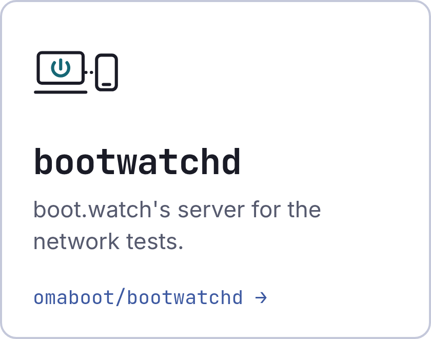
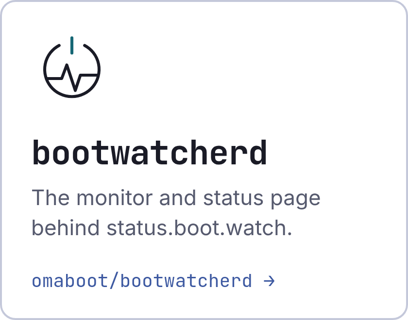
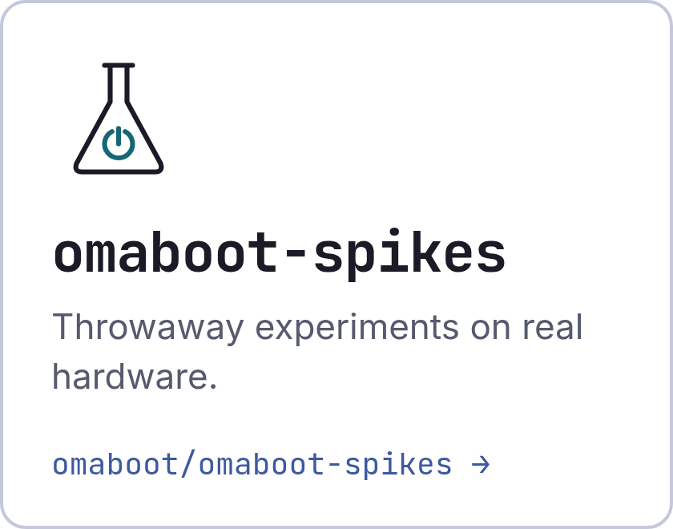

<!-- Featured repo: omaboot.live for now. When the omaboot fork is public on GitHub, replace the featured card and link below with the fork's. -->

<picture>
  <source media="(prefers-color-scheme: dark)" srcset="assets/banner-dark.png">
  
</picture>

**OmaBoot?** is a comprehensive Intel Mac test suite for Omarchy. Plug in a USB stick, boot your Mac from it, and it runs a quick pass over the hardware: Wi-Fi, Ethernet, sleep, thermals, ports and more. You find out how well Omarchy will run before you install anything, and your report can feed [DoesItOmarchy.com](https://doesitomarchy.com), the per-model compatibility catalog.

<a href="https://omaboot.live">
  <picture>
    <source media="(prefers-color-scheme: dark)" srcset="assets/featured-dark.png">
    
  </picture>
</a>

<table>
  <tr>
    <td width="33%">
      <a href="https://github.com/omaboot/bootwatchd">
        <picture>
          <source media="(prefers-color-scheme: dark)" srcset="assets/card-bootwatchd-dark.png">
          
        </picture>
      </a>
    </td>
    <td width="33%">
      <a href="https://github.com/omaboot/bootwatcherd">
        <picture>
          <source media="(prefers-color-scheme: dark)" srcset="assets/card-bootwatcherd-dark.png">
          
        </picture>
      </a>
    </td>
    <td width="33%">
      <a href="https://github.com/omaboot/omaboot-spikes">
        <picture>
          <source media="(prefers-color-scheme: dark)" srcset="assets/card-omaboot-spikes-dark.png">
          
        </picture>
      </a>
    </td>
  </tr>
</table>

Part of the effort to run [Omarchy](https://omarchy.org) on every Intel Mac, 2006 to 2020.
